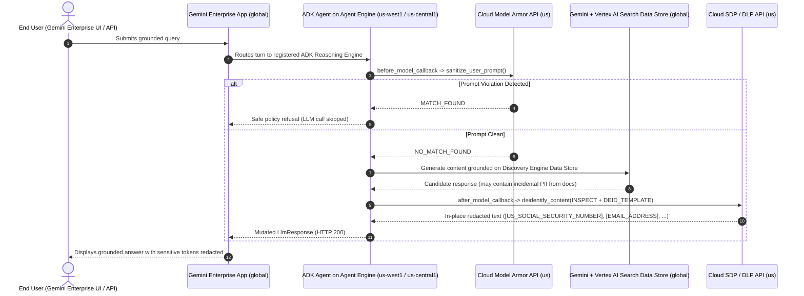

# ADK SDP-Capable Agent Template

A production-ready **Google Agent Development Kit (ADK)** Python template that decouples **pre-inference prompt blocking** from **post-inference in-place PII redaction** for **Gemini Enterprise** and **Vertex AI Agent Engine**.

---

## Why This Pattern?

Native guardrails in **Gemini Enterprise** enforce a binary `INSPECT_AND_BLOCK` action when sensitive content is detected. In enterprise RAG scenarios (legal, financial, healthcare, HR, compliance), grounded answers frequently cite documents that also contain incidental PII (SSNs, routing/account numbers, payment cards, email addresses). A binary block drops the entire response rather than masking only the sensitive tokens.

This template implements a resilient three-stage middleware pipeline using ADK callbacks:

| Stage | ADK Hook / Tool | Google Cloud Service | Action |
| :--- | :--- | :--- | :--- |
| **1. Pre-Inference** | `before_model_callback` | **Cloud Model Armor** (`sanitize_user_prompt`) | **Binary Allow / Block** on prompt injections, jailbreaks, and policy violations before the LLM is called. |
| **2. Grounded Inference** | `LlmAgent` + `VertexAiSearchTool` | **Vertex AI Gemini** + **Discovery Engine Data Store** | Searches your existing Gemini Enterprise Data Store (GCS, Drive, SharePoint, etc.) and synthesizes a grounded answer. |
| **3. Post-Inference** | `after_model_callback` | **Cloud Sensitive Data Protection (SDP / DLP v2)** (`deidentify_content`) | **In-Place Redaction** (`[US_SOCIAL_SECURITY_NUMBER]`, `[EMAIL_ADDRESS]`, `[CREDIT_CARD_NUMBER]`, etc.) returning HTTP `200` with business context preserved. |



---

## Repository Structure

```text
adk-sdp-capable-agent-template/
├── .env.example                 # Environment variable template (copy to .env)
├── Dockerfile                   # Optional container image for Cloud Run / GKE
├── deploy_agent.py              # Automated Vertex AI Agent Engine + Gemini Enterprise deployer
├── run_eval.py                  # Offline simulator & live GCP CLI evaluator
├── config/
│   ├── __init__.py
│   └── settings.py              # Typed Pydantic configuration loaded from env / .env
├── app/
│   ├── __init__.py              # Exports `agent` for `adk web` & `adk deploy agent_engine`
│   ├── requirements.txt         # Runtime dependencies packaged into Agent Engine
│   ├── sdp_service.py           # Cloud SDP (DlpServiceClient), Model Armor, & offline simulator
│   ├── agent.py                 # ADK LlmAgent, callbacks, VertexAiSearchTool, & Runner workflow
│   └── server.py                # FastAPI HTTP wrapper (/health and /chat)
├── docs/
│   └── IMPLEMENTATION_GUIDE.md  # Full architecture, IAM, regional residency, & deployment guide
└── tests/
    └── test_redaction.py        # Offline unit/ADK/FastAPI test suite + optional live_gcp test
```

---

## Quickstart (Zero GCP Credentials Needed)

You can verify the full ADK callback pipeline locally in offline simulation mode right away:

```bash
python3 -m venv .venv
source .venv/bin/activate
pip install -r requirements.txt

# 1. Run the offline unit, ADK callback, and FastAPI test suite
pytest -m "not live_gcp" -v

# 2. Run the built-in synthetic evaluation suite (in-place PII redaction + prompt block)
python run_eval.py --mode simulate --suite
```

---

## Configuring & Deploying to Google Cloud

### 1. Configure Environment Variables

Copy `.env.example` to `.env` and populate your project, template, and Data Store IDs:

```bash
cp .env.example .env
```

| Variable | Description | Example |
| :--- | :--- | :--- |
| `GCP_PROJECT_ID` | Google Cloud Project ID | `my-enterprise-project` |
| `GCP_PROJECT_NUMBER` | Google Cloud Project Number | `123456789012` |
| `SDP_LOCATION` | Cloud SDP & Model Armor template location | `us` |
| `AGENT_ENGINE_REGION` | Regional runtime for Vertex AI Agent Engine | `us-west1` |
| `VERTEX_LOCATION` | Vertex AI Gemini & Data Store endpoint location | `global` |
| `GEMINI_MODEL` | Primary Gemini model on Vertex AI | `gemini-2.5-flash` |
| `MODEL_ARMOR_PROMPT_TEMPLATE_ID` | Model Armor template ID for prompt filtering | `enterprise-prompt-filter` |
| `SDP_INSPECT_TEMPLATE_PATH` | Full Cloud SDP `inspectTemplates` resource name | `projects/.../locations/us/inspectTemplates/...` |
| `SDP_DEIDENTIFY_TEMPLATE_PATH` | Full Cloud SDP `deidentifyTemplates` resource name | `projects/.../locations/us/deidentifyTemplates/...` |
| `GEMINI_ENTERPRISE_ENGINE_ID` | Target Gemini Enterprise App / Engine ID | `my-enterprise-app_1700000000000` |
| `DISCOVERY_ENGINE_DATA_STORE_ID` | Full Discovery Engine Data Store resource path | `projects/.../collections/default_collection/dataStores/...` |

### 2. Provision Least-Privilege IAM

> **No Direct Storage Bucket Access Required:** Because Gemini Enterprise connectors (GCS, Google Drive, SharePoint, etc.) are already indexed by the Discovery Engine Service Agent, this ADK agent only needs `roles/discoveryengine.viewer`—it does **not** need `roles/storage.objectViewer` on raw source buckets.

See [`docs/IMPLEMENTATION_GUIDE.md`](docs/IMPLEMENTATION_GUIDE.md) for the copy-paste `gcloud` script to create the dedicated runtime service account (`adk-sdp-agent-sa`) and bind least-privilege roles.

### 3. Test Live Locally Against GCP

```bash
gcloud auth application-default login
python run_eval.py --mode live --prompt "Summarize key terms from our connected repository."
```

### 4. Deploy to Vertex AI Agent Engine & Register in Gemini Enterprise

```bash
python deploy_agent.py --region us-west1 --display-name "Enterprise SDP Redaction Agent"
```

After registration, grant end-user visibility in Google Cloud Console:
1. Open **Gemini Enterprise** -> select your **App** -> **Agents**.
2. Select **Enterprise SDP Redaction Agent** -> **User permissions** -> **Add user**.
3. Grant the **Agent User** role to specific users, groups, or **All users**.

---

## License

Apache License 2.0 — see [`LICENSE`](LICENSE).
