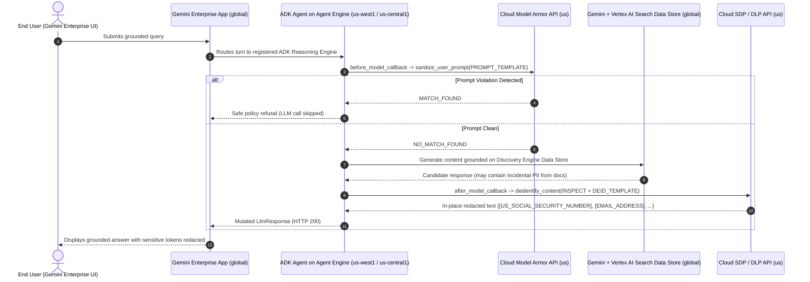

# Reference Architecture: In-Place PII Redaction in Gemini Enterprise Using Google ADK, Model Armor, and Cloud SDP

## 1. Problem Statement & Architectural Pattern

Native guardrails in **Gemini Enterprise** enforce a **binary (`INSPECT_AND_BLOCK`)** action when sensitive data is detected. In enterprise RAG workflows (such as legal, financial, HR, or clinical document repositories), grounded answers legitimately surface facts from documents that also contain incidental PII (SSNs, routing/account numbers, credit cards, email addresses). A binary block rejects the entire response rather than masking only the sensitive spans.

By building a custom **Google Agent Development Kit (ADK)** agent hosted on **Vertex AI Agent Engine** and registered into **Gemini Enterprise**, teams can decouple **input blocking** from **output redaction**:

| Lifecycle Stage | Service Used | Action Taken | Outcome |
| :--- | :--- | :--- | :--- |
| **1. Pre-Inference (`before_model_callback`)** | **Cloud Model Armor** (`sanitize_user_prompt`) | **Binary Allow / Block** | Blocks prompt injections, jailbreaks, and RAI violations before reaching the LLM. |
| **2. Grounded Inference (`LlmAgent` + `VertexAiSearchTool`)** | **Vertex AI Gemini** + **Discovery Engine Data Store** | **Retrieve & Synthesize** | Searches the existing Gemini Enterprise Data Store (e.g., GCS, Drive, SharePoint) and drafts a grounded answer. |
| **3. Post-Inference (`after_model_callback`)** | **Cloud Sensitive Data Protection (SDP / DLP v2)** (`deidentify_content`) | **In-Place Token Redaction** | Replaces sensitive spans with `[INFO_TYPE]` tokens (e.g., `[US_SOCIAL_SECURITY_NUMBER]`, `[EMAIL_ADDRESS]`) while keeping all surrounding business context intact. |

---

## 2. End-to-End Request Flow



---

## 3. Regional & Data Residency Alignment

A common question is how regional **Agent Engine** compute interacts with `global` Gemini Enterprise apps and `us` multi-region security templates:

- **Gemini Enterprise App & Data Stores (`global` or `us`):** Hosted in Discovery Engine.
- **Vertex AI Agent Engine (`us-central1` or `us-west1`):** Agent Engine is a regional compute runtime. A regional Reasoning Engine can be registered directly into a `global` Gemini Enterprise app.
- **Model Armor & Cloud SDP Templates (`us` multi-region):** Pinned explicitly in SDK client configuration (`modelarmor.us.rep.googleapis.com` and `projects/<PROJECT_ID>/locations/us/...`), keeping inspection and de-identification inside the US boundary.

> [!IMPORTANT]
> When Agent Engine starts a container in a region (e.g., `us-west1`), it injects `GOOGLE_CLOUD_LOCATION=us-west1` into the container environment. Explicitly pass `client_kwargs={"vertexai": True, "project": PROJECT_ID, "location": "global"}` to the ADK `Gemini` model object so LLM and `VertexAiSearchTool` calls continue targeting `global`.

---

## 4. Least-Privilege IAM Model (No Direct Connector/Bucket Access Needed)

Because Gemini Enterprise connectors (such as Google Cloud Storage, Google Drive, or SharePoint) are already indexed by the **Discovery Engine Service Agent**, **the ADK agent does NOT need direct read permissions (`roles/storage.objectViewer`, etc.) on the underlying source buckets or repositories.**

Create a dedicated runtime service account for the ADK agent with only these project-level roles:

```bash
export PROJECT_ID="<YOUR_PROJECT_ID>"
export PROJECT_NUMBER="<YOUR_PROJECT_NUMBER>"
export SA_NAME="adk-sdp-agent-sa"
export SA_EMAIL="${SA_NAME}@${PROJECT_ID}.iam.gserviceaccount.com"

gcloud iam service-accounts create "${SA_NAME}" \
  --project="${PROJECT_ID}" \
  --display-name="ADK SDP Redaction Agent Runtime SA"

for ROLE in \
  roles/aiplatform.user \
  roles/discoveryengine.viewer \
  roles/dlp.user \
  roles/dlp.inspectTemplatesReader \
  roles/dlp.deidentifyTemplatesReader \
  roles/modelarmor.user \
  roles/logging.logWriter \
  roles/cloudtrace.agent; do
  gcloud projects add-iam-policy-binding "${PROJECT_ID}" \
    --member="serviceAccount:${SA_EMAIL}" \
    --role="${ROLE}" \
    --condition=None
done

# Allow the Vertex AI Reasoning Engine Service Agent to run as this custom SA
for RE_ROLE in roles/iam.serviceAccountUser roles/iam.serviceAccountTokenCreator; do
  gcloud iam service-accounts add-iam-policy-binding "${SA_EMAIL}" \
    --project="${PROJECT_ID}" \
    --member="serviceAccount:service-${PROJECT_NUMBER}@gcp-sa-aiplatform-re.iam.gserviceaccount.com" \
    --role="${RE_ROLE}"
done
```

---

## 5. Reference Project Structure

```text
adk-sdp-capable-agent-template/
├── config/
│   ├── __init__.py
│   └── settings.py          # Environment-driven project, Model Armor, SDP, and Data Store IDs
└── app/
    ├── __init__.py          # Exports `from . import agent` for Agent Engine discovery
    ├── requirements.txt     # Container dependencies installed by Agent Engine
    ├── sdp_service.py       # Cloud SDP (DlpServiceClient) & Model Armor wrappers
    └── agent.py             # ADK LlmAgent with before_model_callback & after_model_callback
```

### `app/requirements.txt`

```text
google-adk>=2.12.0
google-cloud-dlp>=3.25.0
google-cloud-modelarmor>=0.7.0
google-genai>=2.33.0
pydantic>=2.7.0
```

### `config/settings.py`

```python
import os
from pydantic import BaseModel

class AgentSettings(BaseModel):
    project_id: str = os.getenv("GCP_PROJECT_ID", "<YOUR_PROJECT_ID>")
    sdp_location: str = os.getenv("SDP_LOCATION", "us")
    vertex_location: str = os.getenv("VERTEX_LOCATION", "global")
    gemini_model: str = os.getenv("GEMINI_MODEL", "gemini-2.5-flash")

    prompt_template_path: str = os.getenv(
        "MODEL_ARMOR_PROMPT_TEMPLATE",
        "projects/<YOUR_PROJECT_ID>/locations/us/templates/<PROMPT_TEMPLATE_ID>",
    )
    inspect_template_path: str = os.getenv(
        "SDP_INSPECT_TEMPLATE",
        "projects/<YOUR_PROJECT_ID>/locations/us/inspectTemplates/<INSPECT_TEMPLATE_ID>",
    )
    deidentify_template_path: str = os.getenv(
        "SDP_DEIDENTIFY_TEMPLATE",
        "projects/<YOUR_PROJECT_ID>/locations/us/deidentifyTemplates/<DEID_TEMPLATE_ID>",
    )
    data_store_id: str = os.getenv(
        "DISCOVERY_ENGINE_DATA_STORE_ID",
        "projects/<YOUR_PROJECT_NUMBER>/locations/global/collections/default_collection/dataStores/<DATA_STORE_ID>",
    )
```

### `app/sdp_service.py` (Cloud SDP & Model Armor Helpers)

```python
from typing import Optional
from google.cloud import dlp_v2, modelarmor_v1

class SDPService:
    """Wraps DlpServiceClient.deidentify_content() using Cloud SDP templates."""

    def __init__(self, project_id: str, location: str, inspect_template: str, deid_template: str):
        self.parent = f"projects/{project_id}/locations/{location}"
        self.inspect_template = inspect_template
        self.deid_template = deid_template
        self._client: Optional[dlp_v2.DlpServiceClient] = None

    @property
    def client(self) -> dlp_v2.DlpServiceClient:
        if self._client is None:
            self._client = dlp_v2.DlpServiceClient()
        return self._client

    def deidentify_text(self, text: str) -> str:
        if not text or not text.strip():
            return text
        request = dlp_v2.DeidentifyContentRequest(
            parent=self.parent,
            inspect_template_name=self.inspect_template,
            deidentify_template_name=self.deid_template,
            item=dlp_v2.ContentItem(value=text),
        )
        response = self.client.deidentify_content(request=request)
        return response.item.value


class PromptGuardService:
    """Screens incoming user prompts via Cloud Model Armor (binary block)."""

    def __init__(self, location: str, template_path: str):
        self.location = location
        self.template_path = template_path
        self._client: Optional[modelarmor_v1.ModelArmorClient] = None

    @property
    def client(self) -> modelarmor_v1.ModelArmorClient:
        if self._client is None:
            endpoint = (
                f"modelarmor.{self.location}.rep.googleapis.com"
                if self.location != "global"
                else "modelarmor.googleapis.com"
            )
            self._client = modelarmor_v1.ModelArmorClient(client_options={"api_endpoint": endpoint})
        return self._client

    def is_prompt_blocked(self, prompt: str) -> bool:
        req = modelarmor_v1.SanitizeUserPromptRequest(
            name=self.template_path,
            user_prompt_data=modelarmor_v1.DataItem(text=prompt),
        )
        resp = self.client.sanitize_user_prompt(request=req)
        return (
            int(resp.sanitization_result.filter_match_state)
            == int(modelarmor_v1.FilterMatchState.MATCH_FOUND)
        )
```

### `app/agent.py` (ADK Callbacks & Data Store Grounding)

> [!NOTE]
> In ADK Python, callback parameter names **must** match `callback_context`, `llm_request`, and `llm_response` exactly because ADK invokes callbacks using keyword arguments.

```python
from typing import Optional
from google.adk.agents import LlmAgent
from google.adk.agents.callback_context import CallbackContext
from google.adk.models.google_llm import Gemini
from google.adk.models.llm_request import LlmRequest
from google.adk.models.llm_response import LlmResponse
from google.adk.tools import VertexAiSearchTool
from google.genai import types

from config.settings import AgentSettings
from .sdp_service import PromptGuardService, SDPService

settings = AgentSettings()
prompt_guard = PromptGuardService(settings.sdp_location, settings.prompt_template_path)
sdp_service = SDPService(
    settings.project_id,
    settings.sdp_location,
    settings.inspect_template_path,
    settings.deidentify_template_path,
)


def before_model_callback(
    callback_context: CallbackContext,
    llm_request: LlmRequest,
) -> Optional[LlmResponse]:
    """Pre-inference binary prompt check via Model Armor."""
    user_text = ""
    for content in reversed(llm_request.contents or []):
        if content.role == "user" and content.parts:
            user_text = "\n".join(p.text for p in content.parts if p.text)
            break

    if user_text and prompt_guard.is_prompt_blocked(user_text):
        return LlmResponse(
            content=types.Content(
                role="model",
                parts=[types.Part(text="Request declined by enterprise prompt safety policy.")],
            )
        )
    return None


def after_model_callback(
    callback_context: CallbackContext,
    llm_response: LlmResponse,
) -> Optional[LlmResponse]:
    """Post-inference in-place PII redaction via Cloud SDP."""
    if getattr(llm_response, "partial", False):
        return None
    if not llm_response.content or not llm_response.content.parts:
        return None

    modified = False
    redacted_parts: list[types.Part] = []
    for part in llm_response.content.parts:
        if not part.text or getattr(part, "thought", False):
            redacted_parts.append(part)
            continue
        cleaned = sdp_service.deidentify_text(part.text)
        if cleaned != part.text:
            modified = True
            redacted_parts.append(types.Part(text=cleaned))
        else:
            redacted_parts.append(part)

    if not modified:
        return None

    return LlmResponse(
        content=types.Content(
            role=llm_response.content.role or "model",
            parts=redacted_parts,
        ),
        grounding_metadata=getattr(llm_response, "grounding_metadata", None),
        usage_metadata=getattr(llm_response, "usage_metadata", None),
    )


root_agent = LlmAgent(
    name="enterprise_sdp_redaction_agent",
    model=Gemini(
        model=settings.gemini_model,
        client_kwargs={
            "vertexai": True,
            "project": settings.project_id,
            "location": settings.vertex_location,
        },
    ),
    instruction=(
        "You are an enterprise knowledge assistant. Search the connected data store "
        "to answer user questions accurately and concisely based on source documents."
    ),
    tools=[VertexAiSearchTool(data_store_id=settings.data_store_id)],
    before_model_callback=before_model_callback,
    after_model_callback=after_model_callback,
)
```

---

## 6. Deployment & Registration Runbook

### Step 1: Deploy to Vertex AI Agent Engine

Install `google-adk` and `google-cloud-agentplatform>=2.2.0` locally, then deploy from the repository root:

```bash
adk deploy agent_engine \
  --project="${PROJECT_ID}" \
  --region="us-west1" \
  --display_name="Enterprise SDP Redaction Agent" \
  --service_account="${SA_EMAIL}" \
  --extra_packages=./config \
  ./app
```

Note the output Reasoning Engine resource name:
`projects/<PROJECT_NUMBER>/locations/us-west1/reasoningEngines/<REASONING_ENGINE_ID>`

### Step 2: Register the Agent in Gemini Enterprise

Register the Reasoning Engine into your Gemini Enterprise app (`<ENGINE_ID>`):

```bash
curl -X POST \
  -H "Authorization: Bearer $(gcloud auth print-access-token)" \
  -H "X-Goog-User-Project: ${PROJECT_ID}" \
  -H "Content-Type: application/json" \
  "https://discoveryengine.googleapis.com/v1alpha/projects/${PROJECT_NUMBER}/locations/global/collections/default_collection/engines/${ENGINE_ID}/assistants/default_assistant/agents" \
  -d '{
    "displayName": "Enterprise SDP Redaction Agent",
    "description": "Grounded assistant with Model Armor prompt screening and Cloud SDP in-place redaction.",
    "adkAgentDefinition": {
      "toolSettings": {
        "toolDescription": "Answers enterprise questions grounded on internal documents with automatic PII redaction."
      },
      "provisionedReasoningEngine": {
        "reasoningEngine": "projects/'"${PROJECT_NUMBER}"'/locations/us-west1/reasoningEngines/'"${REASONING_ENGINE_ID}"'"
      }
    }
  }'
```

### Step 3: Grant End-User Access in Cloud Console

Newly registered agents are hidden from end users until shared:
1. In Google Cloud Console, navigate to **Gemini Enterprise** $\rightarrow$ select your **App** $\rightarrow$ **Agents**.
2. Click **Enterprise SDP Redaction Agent** $\rightarrow$ open the **User permissions** tab.
3. Click **Add user**, choose **User**, **Group**, or **All users**, assign the **Agent User** role, and click **Save**.
